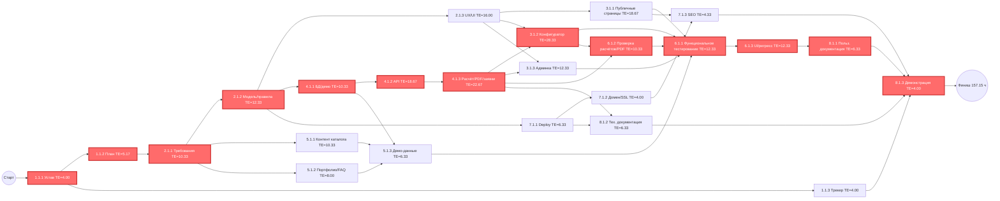

# Сетевой график и PERT-анализ

**Проект:** Веб-сайт строительной компании «СтройСервис»  
**Фаза:** Базовый план  
**Дата:** 23/10/2026  
**Версия:** 1.0  
**Основано на:** ИСР (`Ierarkhicheskaya_struktura.pdf`), Устав (`Ustav_proekta.pdf`)

> **Примечание.** Оценки O/M/P являются экспертными и построены по ИСР и уставу. Если команда имеет собственные оценки, нужно заменить таблицу раздела 2 и пересчитать разделы 3–6.

---

## 1. Методология

Используется трёхточечная оценка PERT:

\[
TE = \frac{O + 4M + P}{6}
\]

\[
\sigma^2 = \left(\frac{P - O}{6}\right)^2
\]

\[
\sigma_{project} = \sqrt{\sum \sigma^2_{\text{критический путь}}}
\]

\[
Z = \frac{T_{\text{дедлайн}} - TE_{\text{крит}}}{\sigma_{project}}
\]

Где:

- **O** — оптимистичная оценка;
- **M** — наиболее вероятная оценка;
- **P** — пессимистичная оценка;
- **TE** — ожидаемая длительность;
- **σ²** — дисперсия.

Допущения:

- команда — 4 человека;
- срок проекта — 21.09.2026–10.10.2026, 21 день;
- оценки даны в чел.-часах;
- для вероятностной оценки принимается, что на критическом пути доступно около **8 ч/день**;
- общая доступная ёмкость команды принимается как **4 чел. × 4 ч/день × 21 день = 336 чел.-ч**.

---

## 2. Оценки пакетов работ

| ID | Пакет работ | O | M | P | TE | σ² | Предшественники |
|---|---|---:|---:|---:|---:|---:|---|
| 1.1.1 | Устав, цели, роли, границы | 2 | 4 | 6 | 4.00 | 0.44 | — |
| 1.1.2 | План работ и контрольные точки | 3 | 5 | 8 | 5.17 | 0.69 | 1.1.1 |
| 1.1.3 | Ведение трекера и статусов | 2 | 4 | 6 | 4.00 | 0.44 | 1.1.1 |
| 2.1.1 | Анализ требований и сценариев | 6 | 10 | 16 | 10.33 | 2.78 | 1.1.2 |
| 2.1.2 | Структура сайта, модель данных, правила расчёта | 8 | 12 | 18 | 12.33 | 2.78 | 2.1.1 |
| 2.1.3 | UX-прототипы и UI-макеты | 10 | 16 | 24 | 16.00 | 5.44 | 2.1.2 |
| 3.1.1 | Главная, каталог, услуги, портфолио, отзывы, FAQ | 12 | 18 | 28 | 18.67 | 7.11 | 2.1.3 |
| 3.1.2 | Конфигуратор, калькулятор, смета, заявка | 18 | 28 | 40 | 28.33 | 13.44 | 2.1.3, 4.1.3 |
| 3.1.3 | Админ-панель, адаптивность, интеграция с API | 8 | 12 | 18 | 12.33 | 2.78 | 2.1.3, 4.1.3 |
| 4.1.1 | База данных и демо-данные | 6 | 10 | 16 | 10.33 | 2.78 | 2.1.2 |
| 4.1.2 | API каталога, конфигуратора, калькулятора | 12 | 18 | 28 | 18.67 | 7.11 | 4.1.1, 2.1.2 |
| 4.1.3 | Расчёт стоимости, PDF, заявки, аутентификация | 14 | 22 | 34 | 22.67 | 11.11 | 4.1.2 |
| 5.1.1 | Контент каталога и услуг | 6 | 10 | 16 | 10.33 | 2.78 | 2.1.1 |
| 5.1.2 | Портфолио, отзывы, FAQ | 4 | 8 | 12 | 8.00 | 1.78 | 2.1.1 |
| 5.1.3 | Демо-данные и тестовые заявки | 4 | 6 | 10 | 6.33 | 1.00 | 4.1.1, 5.1.1, 5.1.2 |
| 6.1.1 | Функциональное тестирование сценариев | 8 | 12 | 18 | 12.33 | 2.78 | 3.1.1, 3.1.2, 3.1.3, 5.1.3, 6.1.2 |
| 6.1.2 | Проверка расчётов и PDF | 6 | 10 | 16 | 10.33 | 2.78 | 4.1.3, 3.1.2 |
| 6.1.3 | UI, адаптивность, регресс | 8 | 12 | 18 | 12.33 | 2.78 | 6.1.1 |
| 7.1.1 | Настройка окружения и deploy | 4 | 6 | 10 | 6.33 | 1.00 | 2.1.2 |
| 7.1.2 | Домен, SSL, хостинг | 2 | 4 | 6 | 4.00 | 0.44 | 7.1.1 |
| 7.1.3 | SEO и аналитика | 2 | 4 | 8 | 4.33 | 1.00 | 7.1.2, 3.1.1 |
| 8.1.1 | Пользовательская документация | 4 | 6 | 10 | 6.33 | 1.00 | 6.1.3 |
| 8.1.2 | Техническая документация | 4 | 6 | 10 | 6.33 | 1.00 | 4.1.3, 7.1.1 |
| 8.1.3 | Демонстрация и приёмка | 2 | 4 | 6 | 4.00 | 0.44 | 8.1.1, 8.1.2, 7.1.3, 1.1.3 |

**Итого:**

| Показатель | Значение |
|---|---:|
| Количество пакетов работ | 24 |
| Суммарная плановая трудоёмкость ΣTE | 253.80 чел.-ч |

---

## 3. Расчёт ранних сроков и резервов

Прямой проход:

```text
ES = max(EF предшественников)
EF = ES + TE
```

Обратный проход использован для расчёта полного резерва:

```text
TF = LS - ES
```

Критические работы имеют `TF = 0`.

| ID | TE | ES | EF | TF |
|---|---:|---:|---:|---:|
| 1.1.1 | 4.00 | 0.00 | 4.00 | 0.00 |
| 1.1.2 | 5.17 | 4.00 | 9.17 | 0.00 |
| 1.1.3 | 4.00 | 4.00 | 8.00 | 145.15 |
| 2.1.1 | 10.33 | 9.17 | 19.50 | 0.00 |
| 2.1.2 | 12.33 | 19.50 | 31.83 | 0.00 |
| 2.1.3 | 16.00 | 31.83 | 47.83 | 35.67 |
| 3.1.1 | 18.67 | 47.83 | 66.50 | 55.66 |
| 3.1.2 | 28.33 | 83.50 | 111.83 | 0.00 |
| 3.1.3 | 12.33 | 83.50 | 95.83 | 26.33 |
| 4.1.1 | 10.33 | 31.83 | 42.16 | 0.00 |
| 4.1.2 | 18.67 | 42.16 | 60.83 | 0.00 |
| 4.1.3 | 22.67 | 60.83 | 83.50 | 0.00 |
| 5.1.1 | 10.33 | 19.50 | 29.83 | 86.00 |
| 5.1.2 | 8.00 | 19.50 | 27.50 | 88.33 |
| 5.1.3 | 6.33 | 42.16 | 48.49 | 73.67 |
| 6.1.1 | 12.33 | 122.16 | 134.49 | 0.00 |
| 6.1.2 | 10.33 | 111.83 | 122.16 | 0.00 |
| 6.1.3 | 12.33 | 134.49 | 146.82 | 0.00 |
| 7.1.1 | 6.33 | 31.83 | 38.16 | 106.66 |
| 7.1.2 | 4.00 | 38.16 | 42.16 | 106.66 |
| 7.1.3 | 4.33 | 66.50 | 70.83 | 82.32 |
| 8.1.1 | 6.33 | 146.82 | 153.15 | 0.00 |
| 8.1.2 | 6.33 | 83.50 | 89.83 | 63.32 |
| 8.1.3 | 4.00 | 153.15 | 157.15 | 0.00 |

---

## 4. Критический путь

Критический путь:

```text
1.1.1 → 1.1.2 → 2.1.1 → 2.1.2 → 4.1.1 → 4.1.2 → 4.1.3 →
3.1.2 → 6.1.2 → 6.1.1 → 6.1.3 → 8.1.1 → 8.1.3
```

Длительность:

```text
4.00 + 5.17 + 10.33 + 12.33 + 10.33 + 18.67 + 22.67 +
28.33 + 10.33 + 12.33 + 12.33 + 6.33 + 4.00
= 157.15 чел.-ч
```

**Смысл:** основной риск сосредоточен в цепочке «требования → модель данных/правила расчёта → БД/API → расчёт стоимости → конфигуратор → проверка расчётов → тестирование → документация → приёмка».

---

## 5. Сетевой график



**Легенда:** красным выделены работы критического пути, `TF = 0`.

---

## 6. Вероятность завершения в срок

Дисперсия критического пути:

```text
σ²крит = 0.44 + 0.69 + 2.78 + 2.78 + 2.78 + 7.11 + 11.11 +
         13.44 + 2.78 + 2.78 + 2.78 + 1.00 + 0.44
       = 50.92
```

Стандартное отклонение:

```text
σproject = √50.92 ≈ 7.14 ч
```

Доступное время на критическом пути при допущении **8 ч/день**:

```text
21 день × 8 ч/день = 168 ч
```

Резерв:

```text
168 − 157.15 = 10.85 ч
```

Z-оценка:

```text
Z = 10.85 / 7.14 ≈ 1.52
```

Вероятность завершения к 10.10.2026:

```text
P ≈ 94%
```

Сравнение с общими ресурсами команды:

| Показатель | Значение |
|---|---:|
| ΣTE по проекту | 253.80 чел.-ч |
| Доступный фонд команды | 336.00 чел.-ч |
| Средняя требуемая загрузка | ≈ 3.02 ч/день на человека |
| Длительность критического пути | 157.15 чел.-ч |
| Требуемая загрузка на критическом пути | ≈ 7.48 ч/день суммарно |

**Вывод:** проект выглядит реализуемым, если команда стабильно работает примерно по 3 часа в день на человека, а на критическом пути поддерживается суммарная загрузка около 7.5–8 часов в день. Если фактическая загрузка на критическом пути упадёт ниже 7 ч/день, резерв исчезнет и вероятность сдачи в срок резко снизится.

---

## 7. Выводы и рекомендации

1. Критический путь проходит через требования, модель данных, backend-расчёты, конфигуратор, проверку расчётов, тестирование, документацию и демонстрацию.
2. Наиболее рискованные пакеты:  
   - `2.1.2` — правила расчёта и модель данных;  
   - `4.1.3` — расчёт стоимости, PDF, заявки;  
   - `3.1.2` — конфигуратор и калькулятор;  
   - `6.1.2` — проверка расчётов и PDF.
3. Работы по контенту, SEO, части админки и трекеру имеют большой резерв и могут выполняться параллельно.
4. При угрозе срокам в первую очередь можно упрощать:  
   - `7.1.3` SEO и аналитика;  
   - `5.1.2` портфолио, отзывы, FAQ;  
   - `3.1.3` расширенная админ-панель;  
   - `8.1.2` детальная техническая документация.
5. Нельзя экономить на `2.1.2`, `4.1.3`, `3.1.2` и `6.1.2`, потому что ошибки в расчётах напрямую влияют на приемку.

---

## 8. Источники

1. ИСР проекта «СтройСервис» (`Ierarkhicheskaya_struktura.pdf`).
2. Устав проекта «Веб-сайт строительной компании „СтройСервис“» (`Ustav_proekta.pdf`).
3. Пример оформления сетевого графика и PERT-анализа (`07-Сетевой-график-и-PERT.md`).
4. Метод PERT, трёхточечная оценка, критический путь.
