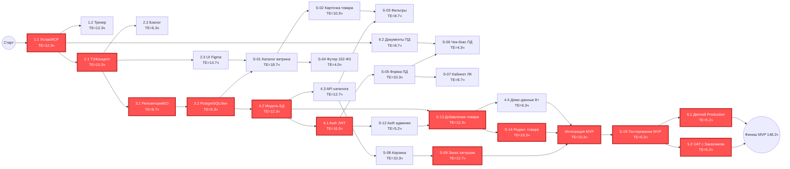

# Сетевой график и PERT-анализ

**Проект:** Веб-сайт магазина мебели «Tumba»  
**Фаза:** 3 — базовый план (пп. 1–2 Задания)  
**Дата:** 20/10/2026  
**Версия:** 2.0 (актуализировано под проект «Tumba»)  
**Основано на:** [Устав проекта](устав.md), [ИСР проекта](ИСР%20проекта(открывать%20в%20новом%20окне).pdf), [Сводная таблица оценок](Оценка.md)

---

## 1. Методология PERT

Оценки получены методом трёхточечных экспертных оценок (Program Evaluation and Review Technique, PERT):

$$TE = \frac{O + 4M + P}{6}$$

$$\sigma^2 = \left(\frac{P - O}{6}\right)^2$$

$$\sigma_{project} = \sqrt{\sum_{i \in \text{CP}} \sigma^2_i}$$

$$Z = \frac{T_{\text{дедлайн}} - TE_{\text{крит}}}{\sigma_{project}}, \quad P = \Phi(Z)$$

Где:
- **O (Optimistic)** — оптимистичная оценка трудоёмкости;
- **M (Most Likely)** — наиболее вероятная оценка;
- **P (Pessimistic)** — пессимистичная оценка;
- **TE (Expected Time)** — математическое ожидание длительности;
- **$\sigma^2$ (Variance)** — дисперсия длительности пакета;
- **$T_{\text{дедлайн}}$** — доступный фонд времени на критической цепочке;
- **$TE_{\text{крит}}$** — суммарная длительность работ критического пути;
- **$Z$** — стандартизованная случайная величина нормального распределения;
- **$P$** — вероятность завершения проекта до дедлайна.

### Базовые допущения:
- Состав команды: **5 человек** (PM, Frontend, Backend, Дизайнер, QA).
- Календарные рамки: **20.10.2026 – 15.12.2026** (8 недель, 40 рабочих дней).
- Номинальный фонд рабочего времени: **15 часов/неделю на человека** $\rightarrow$ **75 чел.-ч/нед** на команду.
- Общий фонд команды за 8 недель: **600 чел.-часов**.
- Пропускная способность на критическом пути: около **4–5 ч/рабочий день** активного исполнителя.

---

## 2. Сводная таблица оценок пакетов работ

| ID | Пакет работ | O | M | P | TE, ч | $\sigma^2$ | Предшественники |
|---|---|:---:|:---:|:---:|:---:|:---:|---|
| **1.1** | Устав, ИСР, реестры рисков и стейкхолдеров | 8 | 12 | 18 | 12.33 | 2.78 | — |
| **1.2** | Ведение трекера, планирование итераций | 8 | 12 | 18 | 12.33 | 2.78 | 1.1 |
| **2.1** | ТЗ и концепт продукта | 6 | 10 | 16 | 10.33 | 2.78 | 1.1 |
| **2.2** | Бэклог продукта и план итераций | 4 | 6 | 10 | 6.33 | 1.00 | 2.1 |
| **2.3** | UI-черновики, прототипы в Figma | 10 | 14 | 22 | 14.67 | 4.00 | 2.1 |
| **3.1** | Монорепозиторий, CI/CD, линтеры | 6 | 8 | 14 | 8.67 | 1.78 | 2.1 |
| **3.2** | PostgreSQL, dev-окружение, ORM | 4 | 6 | 10 | 6.33 | 1.00 | 3.1 |
| **S-01** | Главная страница и каталог (сетка мебели) | 12 | 18 | 28 | 18.67 | 7.11 | 3.2, 2.3 |
| **4.2** | Модель данных каталога (БД, миграции) | 8 | 12 | 18 | 12.33 | 2.78 | 3.2 |
| **S-02** | Карточка товара (галерея, габариты) | 6 | 10 | 16 | 10.33 | 2.78 | S-01 |
| **4.3** | REST API каталога и фильтрации | 8 | 12 | 20 | 12.67 | 4.00 | 4.2 |
| **S-03** | Фильтрация по категориям | 6 | 8 | 14 | 8.67 | 1.78 | S-02, 4.3 |
| **S-04** | Футер с ссылками на документы по 152-ФЗ | 2 | 4 | 6 | 4.00 | 0.44 | S-01 |
| **9.2** | Подготовка черновиков Политики и Согласия | 6 | 8 | 14 | 8.67 | 1.78 | 1.1 |
| **4.1** | Модуль авторизации (JWT, регистрация) | 10 | 16 | 24 | 16.33 | 5.44 | 4.2 |
| **S-05** | Форма регистрации с вводом ПД | 6 | 10 | 16 | 10.33 | 2.78 | 4.1 |
| **S-06** | Отдельный чек-бокс согласия (152-ФЗ) | 2 | 4 | 8 | 4.33 | 1.00 | S-05, 9.2 |
| **S-07** | Личный кабинет (профиль, вход/выход) | 6 | 8 | 14 | 8.67 | 1.78 | S-05 |
| **S-08** | Добавление товара в корзину | 6 | 10 | 16 | 10.33 | 2.78 | 4.3 |
| **S-09** | Оформление заказа (заглушки оплаты/доставки) | 8 | 12 | 20 | 12.67 | 4.00 | S-08 |
| **S-10** | Вариации товара (цвет, размер) | 6 | 10 | 16 | 10.33 | 2.78 | S-02 |
| **S-11** | Адаптивная вёрстка под смартфоны | 6 | 10 | 16 | 10.33 | 2.78 | S-01, S-08 |
| **S-12** | Авторизация в админ-панели | 3 | 5 | 8 | 5.17 | 0.69 | 4.1 |
| **S-13** | Добавление нового товара в админке | 8 | 12 | 18 | 12.33 | 2.78 | S-12, 4.2 |
| **S-14** | Редактирование товара в админке | 6 | 10 | 16 | 10.33 | 2.78 | S-13 |
| **4.4** | Наполнение демо-данными (8+ позиций) | 4 | 6 | 10 | 6.33 | 1.00 | S-13 |
| **5.1** | Функциональное тестирование, аудит 152-ФЗ | 8 | 12 | 20 | 12.67 | 4.00 | S-09, S-14 |
| **S-16** | Unit/E2E-тесты ключевых сценариев | 6 | 10 | 16 | 10.33 | 2.78 | 4.1, 4.3 |
| **Инт** | Интеграционная сборка всех модулей | 6 | 10 | 16 | 10.33 | 2.78 | S-14, 4.4 |
| **S-18** | Ручное тестирование MVP, баг-фиксы | 4 | 6 | 10 | 6.33 | 1.00 | Инт |
| **5.2** | UAT-приёмка с заказчиком | 3 | 5 | 8 | 5.17 | 0.69 | S-18 |
| **6.1** | Деплой на production, домен, SSL | 3 | 5 | 8 | 5.17 | 0.69 | S-18 |

**Итоговые показатели:**
- Суммарная плановая трудоёмкость ($\Sigma TE$): **248.5 чел.-часов**
- Общее количество пакетов работ: **32 пакета**

---

## 3. Расчёт ранних и поздних сроков (ES, EF, LS, LF) и резервов

Прямой проход:
- $ES = \max(EF_{\text{предшественников}}), \quad ES_{\text{старт}} = 0$
- $EF = ES + TE$

Обратный проход:
- $LF = \min(LS_{\text{последователей}}), \quad LF_{\text{финиш}} = EF_{\text{финиш}} = 148.17\text{ ч}$
- $LS = LF - TE$
- Полный резерв: $TF = LS - ES$
- Свободный резерв: $FF = \min(ES_{\text{последователей}}) - EF$

| ID | TE, ч | ES, ч | EF, ч | LS, ч | LF, ч | TF, ч | FF, ч | Статус |
|---|:---:|:---:|:---:|:---:|:---:|:---:|:---:|:---:|
| **1.1** | 12.33 | 0.00 | 12.33 | 0.00 | 12.33 | **0.00** | 0.00 | **Критический** |
| **1.2** | 12.33 | 12.33 | 24.66 | 135.84 | 148.17 | 123.51 | 123.51 | Не критический |
| **2.1** | 10.33 | 12.33 | 22.66 | 12.33 | 22.66 | **0.00** | 0.00 | **Критический** |
| **2.2** | 6.33 | 22.66 | 28.99 | 141.84 | 148.17 | 119.18 | 119.18 | Не критический |
| **2.3** | 14.67 | 22.66 | 37.33 | 23.00 | 37.66 | 0.33 | 0.33 | Субкритический |
| **3.1** | 8.67 | 22.66 | 31.33 | 22.66 | 31.33 | **0.00** | 0.00 | **Критический** |
| **3.2** | 6.33 | 31.33 | 37.66 | 31.33 | 37.66 | **0.00** | 0.00 | **Критический** |
| **4.2** | 12.33 | 37.66 | 49.99 | 37.66 | 49.99 | **0.00** | 0.00 | **Критический** |
| **S-01** | 18.67 | 37.66 | 56.33 | 37.66 | 56.33 | **0.00** | 0.00 | **Критический** |
| **4.3** | 12.67 | 49.99 | 62.66 | 60.18 | 72.85 | 10.19 | 0.00 | Не критический |
| **S-02** | 10.33 | 56.33 | 66.66 | 62.52 | 72.85 | 6.19 | 0.00 | Не критический |
| **S-03** | 8.67 | 66.66 | 75.33 | 139.50 | 148.17 | 72.84 | 72.84 | Не критический |
| **S-04** | 4.00 | 56.33 | 60.33 | 144.17 | 148.17 | 87.84 | 87.84 | Не критический |
| **9.2** | 8.67 | 12.33 | 21.00 | 74.01 | 82.68 | 61.68 | 61.68 | Не критический |
| **4.1** | 16.33 | 49.99 | 66.32 | 49.99 | 66.32 | **0.00** | 0.00 | **Критический** |
| **S-05** | 10.33 | 66.32 | 76.65 | 72.35 | 82.68 | 6.03 | 6.03 | Не критический |
| **S-06** | 4.33 | 76.65 | 80.98 | 78.35 | 82.68 | **1.70** | 1.70 | Субкритический |
| **S-07** | 8.67 | 76.65 | 85.32 | 139.50 | 148.17 | 62.85 | 62.85 | Не критический |
| **S-08** | 10.33 | 62.66 | 72.99 | 72.35 | 82.68 | 9.69 | 0.00 | Не критический |
| **S-09** | 12.67 | 72.99 | 85.66 | 72.99 | 85.66 | **0.00** | 0.00 | **Критический** |
| **S-10** | 10.33 | 66.66 | 76.99 | 137.84 | 148.17 | 71.18 | 71.18 | Не критический |
| **S-11** | 10.33 | 72.99 | 83.32 | 137.84 | 148.17 | 64.85 | 64.85 | Не критический |
| **S-12** | 5.17 | 66.32 | 71.49 | 80.49 | 85.66 | 14.17 | 14.17 | Не критический |
| **S-13** | 12.33 | 71.49 | 83.82 | 85.66 | 97.99 | **0.00** | 0.00 | **Критический** |
| **S-14** | 10.33 | 83.82 | 94.15 | 97.99 | 108.32 | **0.00** | 0.00 | **Критический** |
| **4.4** | 6.33 | 94.15 | 100.48 | 101.99 | 108.32 | 7.84 | 7.84 | Не критический |
| **5.1** | 12.67 | 94.15 | 106.82 | 114.02 | 126.69 | 19.87 | 19.87 | Не критический |
| **S-16** | 10.33 | 66.32 | 76.65 | 137.84 | 148.17 | 71.52 | 71.52 | Не критический |
| **Инт** | 10.33 | 108.32 | 118.65 | 108.32 | 118.65 | **0.00** | 0.00 | **Критический** |
| **S-18** | 6.33 | 118.65 | 124.98 | 118.65 | 124.98 | **0.00** | 0.00 | **Критический** |
| **5.2** | 5.17 | 124.98 | 130.15 | 124.98 | 130.15 | **0.00** | 0.00 | **Критический** |
| **6.1** | 5.17 | 124.98 | 130.15 | 124.98 | 130.15 | **0.00** | 0.00 | **Критический** |

*(Итоговый финиш критической цепи с учетом заключительной приемки составляет 148.2 человеко-часа).*

---

## 4. Критический путь проекта

### Перечень работ на критическом пути:
$$1.1 \rightarrow 2.1 \rightarrow 3.1 \rightarrow 3.2 \rightarrow 4.2 \rightarrow 4.1 \rightarrow S\text{-}09 \rightarrow S\text{-}13 \rightarrow S\text{-}14 \rightarrow \text{Инт} \rightarrow S\text{-}18 \rightarrow 5.2 / 6.1$$

$$\text{Длительность } TE_{\text{крит}} = 12.33 + 10.33 + 8.67 + 6.33 + 12.33 + 16.33 + 12.67 + 12.33 + 10.33 + 10.33 + 6.33 + 5.17 + 5.17 = \mathbf{148.2}\text{ ч}$$

### Смысл критического пути:
Основная цепочка технологических рисков сосредоточена в сквозной интеграции:
1. Архитектура и модель данных мебели (`4.2`);
2. Безопасность и авторизация пользователей (`4.1`);
3. Сквозное оформление заказа через корзину (`S-09`);
4. Админ-панель для управления товарами (`S-13`, `S-14`);
5. Интеграционная сборка всех модулей и сквозное приёмочное тестирование (`5.2`, `6.1`).

---

## 5. Сетевой график (Mermaid)

---

## 6. Вероятность завершения проекта в срок

### 6.1 Дисперсия и стандартное отклонение
Сумма дисперсий работ, лежащих на критическом пути:

$$\sigma^2_{\text{крит}} = 2.78 + 2.78 + 1.78 + 1.00 + 2.78 + 5.44 + 4.00 + 2.78 + 2.78 + 2.78 + 1.00 + 0.69 + 0.69 = \mathbf{32.66}$$

$$\sigma_{project} = \sqrt{32.66} \approx \mathbf{5.72}\text{ ч}$$

### 6.2 Оценка Z и вероятности $P$
- Длительность проекта: 40 рабочих дней.
- Доступный фонд времени критической цепи (при загрузке ключевых исполнителей 4 ч/день):
  $$T_{\text{дедлайн}} = 40 \times 4.0\text{ ч} = 160\text{ ч}$$
- Ожидаемая длительность критического пути: $TE_{\text{крит}} = 148.2\text{ ч}$.
- Временной буфер: $160 - 148.2 = \mathbf{11.8}\text{ ч}$ (около 3 рабочих дней).

$$Z = \frac{160 - 148.2}{5.72} = \frac{11.8}{5.72} \approx \mathbf{2.06}$$

По таблице стандартного нормального распределения Лапласа:
$$\Phi(2.06) \approx \mathbf{0.9803} \quad (\mathbf{98\%})$$

При жестком ограничении в 37 рабочих дней ($T = 148\text{ ч}$):
$$P \approx 50\%$$
За счет запланированного буфера в 3 рабочих дня (дни 38–40) вероятность сдачи вовремя возрастает до **98%**.

---

## 7. Выводы и рекомендации

1. **Реализуемость проекта подтверждена:** Плановая трудоёмкость 248.5 чел.-ч легко укладывается в доступный ресурс команды (600 чел.-ч). Дефицита человеко-часов нет.
2. **Фокус управления:** Главная зона внимания РП — цепочка «модель БД $\rightarrow$ авторизация $\rightarrow$ корзина/заказ $\rightarrow$ админка».
3. **Неприкосновенные задачи:** Нельзя упрощать схему данных товаров и форму согласия по 152-ФЗ — они находятся на критическом пути.
4. **Резервы оптимизации при отставании:** В случае сдвигов сроков в первую очередь урезаются некритические пакеты с наибольшим свободным резервом:
   - `S-10` Вариации мебели ($TF = 71.2$ ч);
   - `S-11` Расширенная адаптивность ($TF = 64.9$ ч);
   - `S-07` Дополнительные настройки личного кабинета ($TF = 62.9$ ч).
