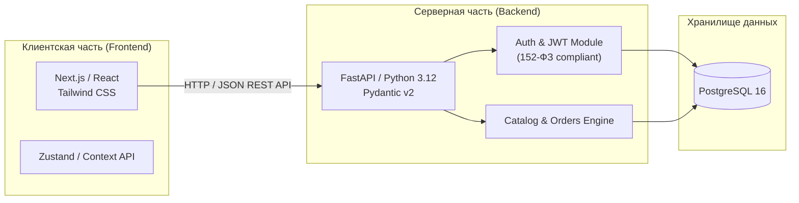

# Tumba — Интернет-магазин мебели

[-blue.svg)](docs/)
[-green.svg)](Жизненный%20цикл%20проекта..md)
[](устав.md)

Учебный проект по дисциплине **«Управление проектами»** (ИСП, 2026).  
Разработка рабочего веб-сайта (прототипа MVP) мебельного магазина «Tumba» с каталогом товаров, личным кабинетом пользователя, оформлением заказов и административной панелью управления.

---

## 📋 О проекте

- **Заказчик:** Физический магазин мебели «Tumba» (недавно открылся, нуждается в онлайн-присутствии и витрине).
- **Исполнитель:** Команда ИСП (5 человек).
- **Методология разработки:** Гибридная (предиктивное планирование на Фазах 1–4 + 4 адаптивные двухнедельные итерации разработки).
- **Сроки проекта:** 20.10.2026 – 15.12.2026 (8 недель активной разработки).
- **Уровень реализации:** Рабочий веб-прототип MVP, воспроизводящий сквозной пользовательский сценарий с использованием демонстрационных данных и программных заглушек (оплата, доставка, смс).
- **Правовое соответствие:** Строгое соблюдение требований Федерального закона № 152-ФЗ «О персональных данных» (отдельный чек-бокс согласия, ссылки в футере на Политику и Согласие).

---

## 👥 Команда проекта и роли

| Роль в проекте | Специализация | Зона ответственности |
|---|---|---|
| **Руководитель проекта (PM)** | Project Manager / Team Lead | Управление проектом, планирование, контроль сроков и бюджета, взаимодействие с заказчиком |
| **Frontend-разработчик** | Frontend Developer | Клиентская часть, интерфейс каталога, корзина, личный кабинет, адаптивность |
| **Backend-разработчик** | Backend Developer | Серверная логика, REST API, архитектура БД PostgreSQL, авторизация (JWT), админка |
| **UI/UX Дизайнер** | UI/UX Designer | Дизайн-макеты в Figma, дизайн-система, прототипы пользовательских путей |
| **QA и специалист по документации** | QA & Compliance | Функциональное тестирование, проверка требований 152-ФЗ, приёмочные акты и документация |

---

## 🛠 Технологический стек и архитектура

### Архитектура: Модульный монолит
Единый веб-сервис с разделением на клиентскую часть (SPA/SSR), серверный REST API и реляционную базу данных.



### Стек технологий:
- **Frontend:** Next.js 14 / React 18, TypeScript, Tailwind CSS, Lucide Icons.
- **Backend:** Python 3.12, FastAPI, SQLAlchemy 2.0 (async), Alembic, Pydantic v2.
- **База данных:** PostgreSQL 16.
- **Тестирование:** Pytest, pytest-asyncio, Playwright / Vitest.
- **CI/CD & Инфраструктура:** Docker, Docker Compose, GitHub Actions.
- **Таск-трекер и управление:** GitHub Projects / Taiga.

---

## 🚀 Быстрый старт и развертывание окружения

### Предварительные требования
Для локального запуска требуются:
- `Git`
- `Docker` и `Docker Compose` (версия 2.20+)
- `Node.js` 20+ и менеджер пакетов `pnpm` (или `npm`)
- `Python` 3.12+ (или утилита `uv`)

### 1. Клонирование репозитория
```bash
git clone https://github.com/JunesQ/Tumba.git
cd Tumba
```

### 2. Запуск инфраструктуры через Docker Compose
```bash
# Поднятие базы данных PostgreSQL и тестового окружения
docker compose up -d postgres

# Проверка статуса контейнера базы данных
docker compose ps
```

### 3. Настройка и запуск бэкенда (Backend)
```bash
cd backend

# Создание виртуального окружения и установка зависимостей
python -m venv .venv
source .venv/bin/activate  # для Linux/macOS
# .venv\Scripts\activate   # для Windows

pip install -r requirements.txt

# Применение миграций базы данных
alembic upgrade head

# Наполнение демонстрационными данными (не менее 8 товаров мебели)
python scripts/seed_demo_data.py

# Запуск dev-сервера FastAPI
uvicorn app.main:app --reload --port 8000
```
Документация API (Swagger UI) доступна по адресу: `http://localhost:8000/docs`

### 4. Настройка и запуск фронтенда (Frontend)
```bash
cd ../frontend

# Установка зависимостей
pnpm install

# Запуск сервера разработки
pnpm dev
```
Веб-приложение доступно по адресу: `http://localhost:3000`

---

## 📊 Документация проекта по фазам (Artifacts Navigation)

Вся проектная документация разработана в строгом соответствии с требованиями практического задания по предмету «Управление проектами».

### Этап 1: Предиктивное планирование (Фазы 1–4)

| Фаза | Наименование артефакта | Файл документа | Описание |
|:---:|---|---|---|
| **Фаза 1** | **Концепт-документ** | [`Концепт-документ.md`](Концепт-документ.md) | Легенда магазина «Tumba», бизнес-проблема, роли пользователей, границы MVP и результаты интервью с заказчиком |
| **Фаза 2** | **Анализ методологий и ЖЦ** | [`Жизненный цикл проекта..md`](Жизненный%20цикл%20проекта..md) | Модель Киневин (Cynefin), Agile Suitability Model, обоснование выбора гибридного подхода |
| **Фаза 2** | **Устав проекта** | [`устав.md`](устав.md) | SMART-цели, границы (scope), полномочия РП, фонд времени команды, ставки, чек-лист приёмки |
| **Фаза 2** | **Реестр заинтересованных сторон** | [`Реестр заинтересованных сторон.md`](Реестр%20заинтересованных%20сторон.md) | 8 ключевых стейкхолдеров, анализ влияния и интереса, стратегии взаимодействия и следствия |
| **Фаза 2** | **ИСР проекта (WBS)** | [`ИСР проекта(открывать в новом окне).pdf`](ИСР%20проекта(открывать%20в%20новом%20окне).pdf) | Иерархическая структура работ на 3 уровнях декомпозиции (20+ пакетов работ) |
| **Фаза 3** | **Сводная таблица оценок** | [`Оценка.md`](Оценка.md) | Трёхточечная оценка пакетов ИСР (PERT), расчёт стоимости, трудоёмкости и буферов |
| **Фаза 3** | **Сетевой график и PERT** | [`PERT.md`](PERT.md) | Прямой и обратный проход (ES, EF, LS, LF), критический путь, дисперсия и вероятность завершения в срок |
| **Фаза 3** | **Расписание и диаграмма Ганта** | [`Расписание.md`](Расписание.md) | Календарный план 20.10–15.12, диаграмма Ганта по ролям, разрешение ресурсных конфликтов |
| **Фаза 3** | **Реестр рисков** | [`Реестр рисков.md`](Реестр%20рисков.md) | 10 идентифицированных рисков (матрица 5×5), стратегии реагирования, планы «Б», риски ИИ и 152-ФЗ |
| **Фаза 4** | **Story Map продукта** | [`Story Map.md`](Story%20Map.md) | Карта пользовательских историй по ролям (Покупатель, Админ, Сборщик), трассировка к ИСР |
| **Фаза 4** | **Бэклог продукта и план итераций** | [`Бэклог продукта и план итераций.md`](Бэклог%20продукта%20и%20план%20итераций.md) | Приоритизация по MoSCoW, нарезка на 4 итерации с демонстрационными результатами |
| **Фаза 4** | **План и бэклог 1-й итерации** | [`План и бэклог первой итерации.md`](План%20и%20бэклог%20первой%20итерации.md) | Оценка в Story Points (Planning Poker: 12 SP), декомпозиция на 26 подзадач, DoR/DoD, план демо |

---

## 📌 Таск-трекинг и управление разработкой

В соответствии с общими положениями задания:
- Все работы декомпозируются на задачи в таск-трекере (GitHub Projects).
- Используется единая колоночная доска: `To Do` → `In Progress` → `Review / Testing` → `Done / Accepted`.
- Каждый участник команды ежедневно фиксирует фактически затраченные часы по своим задачам для последующего план-фактного анализа и расчёта освоенного объёма (EVM).

---

## 📄 Лицензия

Учебный проект для демонстрации в рамках университетского курса по управлению IT-проектами. Все демонстрационные данные синтетические.
