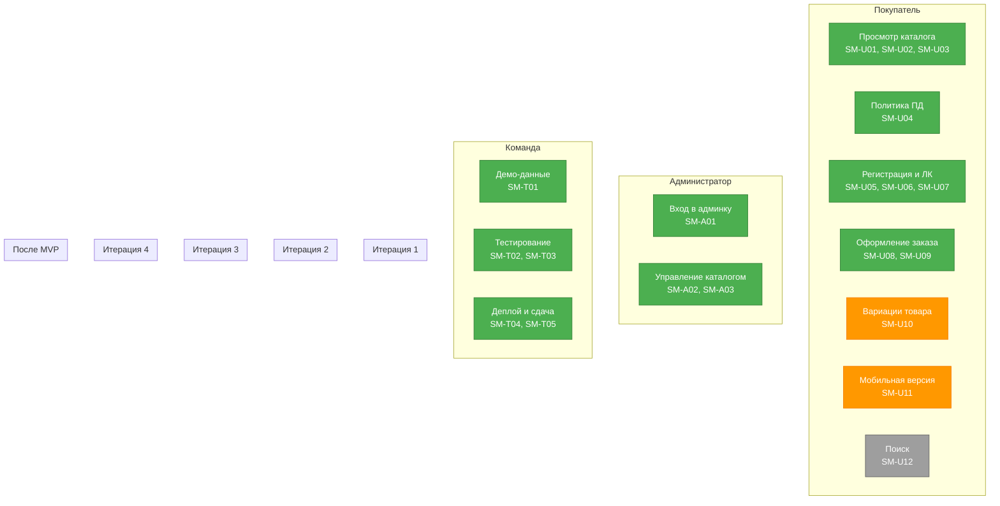

# Story map продукта Tumba

**Фаза:** 4 — story map и бэклог продукта  
**Проект:** Tumba — разработка веб-сайта магазина мебели  
**Основание:** Устав проекта, ИСР (`ИСР проекта`), Бэклог продукта и план итераций

## Как читать карту

Верхний уровень карты — роли и активности пользователя, под ними — пользовательские истории. В колонке «ИСР» указаны листовые пакеты работ, необходимые для истории. Если сценарий затрагивает несколько модулей (Frontend, Backend, QA), перечислены все соответствующие пакеты.

Обозначения: **MVP** — входит в текущий объём; **Could** — следующая итерация после MVP; **Won't** — за пределами согласованного объёма (зафиксировано в Уставе).

---

## Покупатель (конечный пользователь)

### Просмотреть каталог мебели

| ID | Пользовательская история | ИСР | Итерация | Объём |
|---|---|---|---|---|
| SM-U01 | Как покупатель, я хочу открыть главную страницу и увидеть сетку товаров мебели (название, цена, изображение), чтобы быстро оценить ассортимент. | 4.2, 4.3 | Ит1 | MVP |
| SM-U02 | Как покупатель, я хочу отфильтровать товары по категориям (Диваны, Столы, Шкафы и т.д.), чтобы найти нужный тип мебели. | 4.2, 4.3 | Ит1 | MVP |
| SM-U03 | Как покупатель, я хочу открыть карточку товара и увидеть название, цену, изображение и описание, чтобы принять решение о покупке. | 4.2, 4.3 | Ит1 | MVP |

### Ознакомиться с политикой обработки персональных данных

| ID | Пользовательская история | ИСР | Итерация | Объём |
|---|---|---|---|---|
| SM-U04 | Как покупатель, я хочу видеть в футере сайта ссылку на «Политику обработки персональных данных» и «Согласие на обработку персональных данных», чтобы знать свои права. | 4.3, 9.2 | Ит1 | MVP |

### Зарегистрироваться и войти в личный кабинет

| ID | Пользовательская история | ИСР | Итерация | Объём |
|---|---|---|---|---|
| SM-U05 | Как покупатель, я хочу зарегистрироваться в личном кабинете с вводом персональных данных (ФИО, email, телефон), чтобы оформлять заказы. | 4.1, 4.3 | Ит2 | MVP |
| SM-U06 | Как покупатель, я хочу при регистрации дать согласие на обработку персональных данных через отдельный чек-бокс (требование 152-ФЗ), чтобы мои данные обрабатывались законно. | 4.1, 4.3, 9.2 | Ит2 | MVP |
| SM-U07 | Как покупатель, я хочу войти в личный кабинет по логину и паролю и выйти из него, чтобы управлять своим профилем и заказами. | 4.1, 4.3 | Ит2 | MVP |

### Оформить заказ

| ID | Пользовательская история | ИСР | Итерация | Объём |
|---|---|---|---|---|
| SM-U08 | Как покупатель, я хочу добавить товар в корзину, чтобы собрать список покупок перед оформлением заказа. | 4.2, 4.3 | Ит2 | MVP |
| SM-U09 | Как покупатель, я хочу оформить заказ через форму (с имитацией оплаты и доставки заглушками), чтобы завершить покупку. | 4.2, 4.3 | Ит2 | MVP |

### Выбрать вариацию товара

| ID | Пользовательская история | ИСР | Итерация | Объём |
|---|---|---|---|---|
| SM-U10 | Как покупатель, я хочу выбрать вариацию товара в карточке (цвет обивки, размер) без дублирования карточки, чтобы получить нужную конфигурацию мебели. | 4.2 | Ит2 | MVP (Should — 2-й на урезание) |

### Использовать сайт с мобильного

| ID | Пользовательская история | ИСР | Итерация | Объём |
|---|---|---|---|---|
| SM-U11 | Как покупатель, я хочу пользоваться сайтом со смартфона (адаптивная верстка каталога и корзины), чтобы заказывать мебель из любого места. | 4.3 | Ит2 | MVP (Should — 1-й на урезание) |

### Найти товар (будущее)

| ID | Пользовательская история | ИСР | Итерация | Объём |
|---|---|---|---|---|
| SM-U12 | Как покупатель, я хочу найти товар по строке поиска, чтобы быстро перейти к нужной мебели. | — (вне ИСР) | после MVP | Could |

---

## Администратор (сотрудник магазина)

### Войти в панель администратора

| ID | Пользовательская история | ИСР | Итерация | Объём |
|---|---|---|---|---|
| SM-A01 | Как администратор, я хочу войти в панель администратора под отдельной ролью, чтобы управлять каталогом товаров. | 4.1, 4.2 | Ит3 | MVP |

### Управлять каталогом товаров

| ID | Пользовательская история | ИСР | Итерация | Объём |
|---|---|---|---|---|
| SM-A02 | Как администратор, я хочу добавить новый товар в каталог через админ-панель (название, цена, фото), чтобы расширить ассортимент магазина. | 4.2, 4.3 | Ит3 | MVP |
| SM-A03 | Как администратор, я хочу отредактировать существующий товар в админ-панели (изменить цену, описание, фото), чтобы поддерживать каталог актуальным. | 4.2, 4.3 | Ит3 | MVP |

---

## Сборщик мебели (будущее)

### Получить заявку на сборку

| ID | Пользовательская история | ИСР | Итерация | Объём |
|---|---|---|---|---|
| SM-B01 | Как сборщик мебели, я хочу видеть список заявок на сборку в своём личном кабинете, чтобы планировать работу. | — (вне ИСР) | после MVP | Could |

---

## Команда проекта

### Подготовить демо-данные

| ID | Пользовательская история | ИСР | Итерация | Объём |
|---|---|---|---|---|
| SM-T01 | Как команда проекта, мы хотим наполнить сайт демонстрационными данными (не менее 8 товаров мебели), чтобы продемонстрировать работоспособность MVP. | 4.4 | Ит3 | MVP |

### Протестировать продукт

| ID | Пользовательская история | ИСР | Итерация | Объём |
|---|---|---|---|---|
| SM-T02 | Как команда проекта, мы хотим прогнать unit/e2e-тесты backend и frontend, чтобы убедиться в корректности работы системы. | 5.1 | Ит3 | MVP |
| SM-T03 | Как команда проекта, мы хотим пройти ручное тестирование MVP, проверить соответствие 152-ФЗ и закрыть баг-фиксы. | 5.1, 5.2 | Ит4 | MVP |

### Развернуть и сдать проект

| ID | Пользовательская история | ИСР | Итерация | Объём |
|---|---|---|---|---|
| SM-T04 | Как команда проекта, мы хотим развернуть сайт на production-сервере, настроить домен и SSL, чтобы сайт был доступен пользователям. | 6.1 | Ит4 | MVP |
| SM-T05 | Как команда проекта, мы хотим сдать приёмочные материалы (Акт приёма-передачи, инструкции для админа, Политика ПД, Согласие), чтобы формально закрыть проект. | 9.2 | Ит4 | MVP |

---

## Заказчик (магазин «Tumba»)

### Принять и проверить продукт

| ID | Пользовательская история | ИСР | Итерация | Объём |
|---|---|---|---|---|
| SM-Z01 | Как заказчик, я хочу демонстрировать систему на демо-данных (сквозной сценарий: просмотр каталога → добавление в корзину → оформление заказа), чтобы убедиться, что продукт работает по сценарию. | 5.2 | Ит3 | MVP |

---

## Неавторизованный посетитель

| ID | Пользовательская история | ИСР | Итерация | Объём |
|---|---|---|---|---|
| SM-G01 | Как посетитель сайта, я хочу видеть каталог мебели без регистрации, чтобы оценить ассортимент магазина перед созданием аккаунта. | 4.2, 4.3 | Ит1 | MVP |
| SM-G02 | Как посетитель, я хочу перейти по ссылке в футере и прочитать Политику обработки персональных данных, чтобы понять, как сайт обращается с моими данными. | 4.3, 9.2 | Ит1 | MVP |

---

## Won't (в этом релизе)

Зафиксировано в Уставе проекта (раздел «Что НЕ входит в проект»):

- Реальная интеграция с платежными шлюзами (оплата имитируется заглушками)
- Реальная интеграция со службами доставки (доставка имитируется заглушками)
- Интеграция с 1С, CRM и складскими системами
- Нативное мобильное приложение (iOS/Android) — только адаптивная вёрстка
- Пост-релизная поддержка и обучение сотрудников заказчика
- Регистрация оператора персональных данных в Роскомнадзоре (только комплект документов)

---

## Визуализация Story Map

---

## Источники

1. Устав проекта «Tumba» (`устав.md`)
2. ИСР проекта Tumba (`ИСР проекта`)
3. Бэклог продукта и план итераций (`Бэклог продукта и план итераций.md`)
4. Реестр рисков (`Реестр рисков.md`)
5. Реестр заинтересованных сторон (`Реестр заинтересованных сторон.md`)
6. Расписание и диаграмма Ганта (`Расписание.md`)
