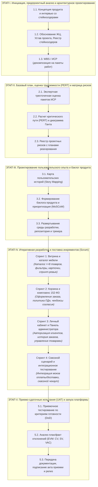

# Анализ применимости методологий и обоснование модели жизненного цикла

**Проект:** Разработка веб-платформы и интернет-магазина мебели «Tumba»  
**Заказчик:** Торговая компания / Сеть мебельных салонов «Tumba»  
**Исполнитель:** Команда продуктовой разработки (Project Lead, Frontend Engineer, Backend Engineer, UI/UX Designer, QA Engineer)  
**Основания разработки:** Концепция продукта, Бизнес-требования (BRD), [Устав проекта](устав(1).md), Реестр стейкхолдеров  
**Версия документа:** 2.0 (Production / Commercial)  
**Статус:** Согласовано со стейкхолдерами

---

## 1. Введение и бизнес-цели анализа

Цель настоящего документа — провести анализ контекста проекта, оценить применимость классических и гибких методологий управления разработкой ПО и зафиксировать целевую модель жизненного цикла (ЖЦ) для создания онлайн-платформы мебельного магазина «Tumba».

Для обеспечения баланса между предсказуемостью сроков/бюджета и гибкостью создания пользовательских интерфейсов в проекте принята **гибридная модель управления (Water-Scrum-Fall)**:
- **Предиктивный контур (Waterfall / PMBOK):** Предпроектные исследования, фиксация бизнес-целей, проектирование архитектуры данных, юридический комплаенс по 152-ФЗ, финансовое и ресурсное планирование (PERT), матрица рисков.
- **Адаптивный контур (Scrum):** Итеративная разработка функциональных модулей (каталог, корзина, личный кабинет, админ-панель) двухнедельными спринтами с регулярными демонстрациями инкрементов заказчику.
- **Контур приёмки и релиза:** Сквозное интеграционное тестирование, приемо-сдаточные испытания (UAT) по чек-листу критериев готовности (DoD/Acceptance Criteria) и ввод в эксплуатацию.

---

## 2. Анализ контекста проекта по модели Cynefin (Кеневин)

Для выбора оптимальных инструментов управления каждый функциональный блок проекта классифицирован по фреймворку принятия решений Cynefin.

| Функциональный блок платформы «Tumba» | Домен Cynefin | Обоснование сложности и специфика ритейла мебели | Стратегия реализации |
|:---|:---:|:---|:---|
| **Реляционная архитектура БД и каталог мебели** | **Сложный (Complicated)** | Многопараметрическая номенклатура мебели (габариты, материалы, расцветки, категории, складские артикулы). Задача требует экспертного проектирования структуры связей и индексов. Решения известны экспертам (Good Practices). | Предиктивное проектирование ER-диаграммы и схемы данных до начала кодинга |
| **Комплаенс с ФЗ-152 «О персональных данных»** | **Сложный (Complicated)** | Сбор данных покупателей при регистрации и заказе требует строгого соблюдения законодательства РФ (политика конфиденциальности, формы согласий, раздельный сбор данных). Нарушения несут прямые юридические риски. | Экспертный правовой анализ, фиксация жестких требований в ТЗ и их предиктивная реализация |
| **UX/UI витрины мебели и карточки товара** | **Запутанный (Complex)** | Удобство восприятия габаритов мебели, наглядность фотографий и простота фильтрации напрямую формируют конверсию в покупку. Поведение клиентов требует проверки гипотез на живых интерфейсах (Emergent Practice). | Адаптивная разработка: кликабельный прототип $\rightarrow$ демо-тест со стейкхолдерами $\rightarrow$ доработка по фидбэку |
| **Сценарий корзины и оформления заказа** | **Запутанный (Complex)** | Баланс между достаточным сбором параметров (адрес, подъём на этаж, телефон) и минимизацией процента брошенных корзин. Оптимальный сценарий определяется опытным путем. | Итеративное прототипирование и полировка пользовательского пути (CJM) |
| **Административная панель управления контентом** | **Сложный (Complicated)** | Реализация стандартных CRUD-операций (добавление, редактирование, удаление товаров, изменение цен и статусов заказов). Алгоритмы детерминированы. | Разработка по зафиксированной технической спецификации в рамках выделенного спринта |
| **Инфраструктура, репозиторий, CI/CD, хостинг** | **Простой (Clear)** | Стандартный стек (Vite / React / Node / PostgreSQL), репозиторий GitHub, статический и серверный хостинг. Опирается на устоявшиеся отраслевые практики (Best Practices). | Реализация по типовым регламентам и чек-листам настройки окружения |
| **Внешние сервисы (эквайринг, доставка)** | **Простой / Мокирование** | На этапе запуска MVP интеграция с реальными банками и логистическими операторами вынесена за рамки первой очереди и изолирована через программные заглушки (Stubs/Mocks). | Разработка детерминированных заглушек в рамках согласованных границ проекта |

**Вывод по модели Cynefin:**  
Архитектурно-нормативное ядро платформы относится к **сложному домену (Complicated)** и требует глубокого проектирования на этапе инициации. В то же время клиентский интерфейс относится к **запутанному домену (Complex)**, где жесткий Waterfall создает риск выпустить неконверсионный продукт. Следовательно, проект требует объединения предварительного проектирования с итеративной разработкой.

---

## 3. Оценка пригодности гибких подходов (Agile Suitability Model — ASM)

Оценка применимости Agile-методологий проведена по шкале от 1 (строгий Waterfall) до 5 (чистый Agile) по 8 ключевым параметрам.

| № | Фактор модели ASM | Оценка (1–5) | Анализ условий реализации проекта «Tumba» |
|:---:|:---|:---:|:---|
| 1 | **Определённость требований** | **3** | Ключевые границы MVP (каталог от 8 позиций, корзина, ЛК, админка) жестко очерчены, но интерфейсные решения и детали клиентского пути уточняются по ходу проекта. |
| 2 | **Вероятность изменений** | **3** | Владелец продукта (Product Owner от магазина) вправе корректировать приоритеты бэклога на демо-сессиях, при этом рамки бюджета и базовый функционал стабильны. |
| 3 | **Регулярность приёмки результатов** | **5** | Бизнес-стейкхолдеры проводят валидацию работающего инкремента каждые 2 недели. |
| 4 | **Доступность заказчика** | **4** | Выделенный Product Owner со стороны мебельного салона участвует в регулярных спринт-ревью каждые 2 недели и доступен для оперативных согласований. |
| 5 | **Размер и структура команды** | **5** | Команда из 5 профильных специалистов (PM, Frontend, Backend, UI/UX, QA) представляет собой сбалансированную Scrum-команду с высокой скоростью принятия решений. |
| 6 | **Критичность дефектов / Цена ошибки** | **4** | Разработка нового цифрового канала не останавливает текущую деятельность офлайн-магазина; риски сбоев локализованы в рамках запускаемой системы. |
| 7 | **Необходимость предварительной оценки сроков** | **2** | Требование инвесторов и руководства зафиксировать верхнеуровневый бюджет, график и дедлайн запуска обязывает составить ИСР (WBS) и расчет по методу PERT. |
| 8 | **Зависимость от внешних систем** | **4** | За счет изоляции внешних интеграций через модули-заглушки на первом этапе проекта внешняя зависимость минимизирована. |

**Итоговый индекс пригодности Agile:** **3.75 из 5.0**.  
Оценка показывает высокую эффективность спринтовой разработки для создания интерфейсов и логики при наличии строгого предиктивного плана по срокам и вехам.

---

## 4. Специфика контекста и ресурсные ограничения

1. **Ресурсная емкость команды:**  
   Полезный фонд рабочего времени проектной группы зафиксирован в объеме **15–20 человеко-часов в неделю** на команду. Ограниченность ресурса требует жесткого контроля критического пути и недопущения неконтролируемого разрастания скоупа (Scope Creep).
2. **Финансовый и проектный мониторинг:**  
   Управление проектом предусматривает регулярный расчет показателей методом освоенного объема (**Earned Value Management — EVM**: PV, EV, AC, отклонения по срокам SV и затратам CV). Для этого каждый элемент пользовательских историй бэклога напрямую привязан к пакетам работ базовой ИСР (WBS).
3. **Нормативные требования (152-ФЗ РФ):**  
   Юридическая чистота сбора персональных данных является обязательным условием для старта коммерческой эксплуатации платформы.

---

## 5. Сравнительный анализ моделей жизненного цикла

| Параметр сравнения | Каскадная модель (Waterfall) | Чистый Agile (Scrum / Kanban) | Выбранная модель: Гибридная (Water-Scrum-Fall) |
|:---|:---|:---|:---|
| **Управление рисками сроков** | Высокий риск срыва дедлайна при интеграции в конце | Риск сдвига общего релиза из-за постоянной смены приоритетов | **Критический путь и дедлайн защищены расчетом PERT и диаграммой Ганта** |
| **Риск невостребованности продукта** | Критический: заказчик видит готовый сайт только на релизе | Низкий: продукт дорабатывается непрерывно | **Минимальный: демонстрация работающего функционала каждые 2 недели** |
| **Фиксация бюджета и ресурсов** | Фиксируются на старте в полном объеме | Бюджет плавающий (Time & Materials) | **Бюджет и фонд времени фиксируются; скоуп фич второго плана адаптивен** |
| **Реакция на изменения** | Блокируется до завершения этапа | Мгновенная адаптация на лету | **Изменения вносятся через контролируемый бэклог продукта без срыва ключевых вех** |

---

## 6. Целевая модель жизненного цикла проекта «Tumba»

Проект реализуется в рамках сквозного жизненного цикла, состоящего из этапа предпроектного планирования, четырех итераций непосредственной разработки и этапа ввода в эксплуатацию:

### План-график фаз и поставляемые результаты (Deliverables):

1. **Фаза инициации и концепции:**
   - *Результаты:* Концепт-документ продукта, техническое описание сквозного сценария, согласованные роли пользователей (Покупатель, Администратор магазина).
2. **Фаза базового планирования и проектирования:**
   - *Результаты:* Устав проекта «Tumba», Реестр заинтересованных сторон с матрицей влияния/интереса, Иерархическая структура работ (WBS на 3 уровнях), схема данных PostgreSQL.
3. **Фаза количественной оценки и расписания:**
   - *Результаты:* Сводная таблица трехточечных оценок трудоемкости, сетевой график с расчетом ранних/поздних сроков и резервов времени, вероятностная оценка срока сдачи по формулам PERT, диаграмма Ганта с фиксацией ресурсных ограничений, реестр рисков с планом превентивных мер.
4. **Фаза предпусковой подготовки (Нулевой спринт):**
   - *Результаты:* Story Map продукта с трассировкой историй на пакеты WBS, бэклог продукта в таск-трекере, развернутый репозиторий с базовой сборкой (Vite, React, Tailwind, Node), оцененный бэклог Спринта 1.
5. **Фаза итеративной разработки (Спринты 1–4):**
   - **Спринт 1 (Каталог):** Рабочая витрина интернет-магазина, каталог с параметрами мебели (название, размеры, материал, цена, фото), фильтрация по категориям. Демо-показ инкремента стейкхолдерам.
   - **Спринт 2 (Корзина и 152-ФЗ):** Механизм добавления товаров в корзину, динамический пересчет суммы, форма оформления заказа, юридически выверенные формы согласия на обработку ПДн и страницы Политики конфиденциальности. Демо-показ инкремента.
   - **Спринт 3 (Личный кабинет и Админка):** Регистрация и аутентификация клиентов, закрытая панель администратора для наполнения витрины, редактирования характеристик мебели и модерации заказов. Демо-показ инкремента.
   - **Спринт 4 (Сквозной сценарий и стабилизация):** Сквозной бизнес-процесс покупки (выбор $\rightarrow$ корзина $\rightarrow$ подтверждение заказа $\rightarrow$ появление заказа в админке), заглушки сервисов эквайринга и доставки, нагрузочное и кроссбраузерное тестирование.
6. **Фаза приемочных испытаний и ввода в действие:**
   - *Результаты:* Протокол приемо-сдаточных испытаний (UAT) по чек-листу Устава, итоговый отчет выполнения проекта с анализом освоенного объема (EVM), журнал учета изменений, развернутая релизная версия платформы.

---

## 7. Разграничение контуров управления

| Контур управления | Состав элементов | Регламент изменений |
|:---|:---|:---|
| **Предиктивный контур (Жесткий)** | Бизнес-цели проекта, дедлайн ввода в эксплуатацию, бюджетный фонд рабочего времени, соответствие 152-ФЗ, ключевые критерии приемки. | **Строгий контроль.** Любые корректировки возможны исключительно через процедуру запроса на изменение (Change Request) с оценкой влияния на срок и бюджет. |
| **Адаптивный контур (Гибкий)** | Детализация пользовательских сценариев в бэклоге спринта, элементы UI-дизайна, технические решения реализации компонентов, второстепенные функции каталога. | **Высокая адаптивность.** Содержание спринта формируется на этапе планирования на основе обратной связи от Product Owner. |

---

## 8. Производственный инструментарий проекта

1. **Таск-менеджмент и контроль прогресса (GitHub Projects / Jira):** Прозрачный трекинг задач команды, ежедневный учет фактически затраченного времени, контроль движения задач по колонкам (`Backlog` $\rightarrow$ `Ready for Dev` $\rightarrow$ `In Progress` $\rightarrow$ `Code Review / QA` $\rightarrow$ `Done`).
2. **Контроль версий и управление кодовой базой (Git / GitHub):** Ветвление по модели GitFlow / GitHub Flow, обязательное рецензирование кода (Pull Request Review) перед слиянием в основную ветку.
3. **Методология оценивания:** Трёхточечный PERT-анализ для утверждения базового плана проекта; Planning Poker в Story Points для оценки сложности историй внутри спринтов.
4. **Контроль метрик эффективности:** Регулярный замер скорости команды (Velocity), построение графиков сгорания задач (Burndown Charts) и расчет показателей освоенного объема (EVM: CPI, SPI, EAC).

---

## 9. Заключение

Выбранная модель **Water-Scrum-Fall** оптимальна для проекта создания платформы «Tumba»:
1. **Защита инвестиций и сроков:** Наличие утвержденного базового плана, рассчитанного критического пути и резервов времени гарантирует запуск MVP в установленный дедлайн без перерасхода бюджета.
2. **Гибкость продукта:** Разработка двухнедельными спринтами обеспечивает создание удобного для конечных покупателей интерфейса с возможностью оперативной калибровки UX на основе бизнес-демонстраций.
3. **Юридическая надежность:** Предиктивный учет требований ФЗ-152 защищает бизнес от юридических рисков и блокировок со стороны регулятора с первого дня релиза.
