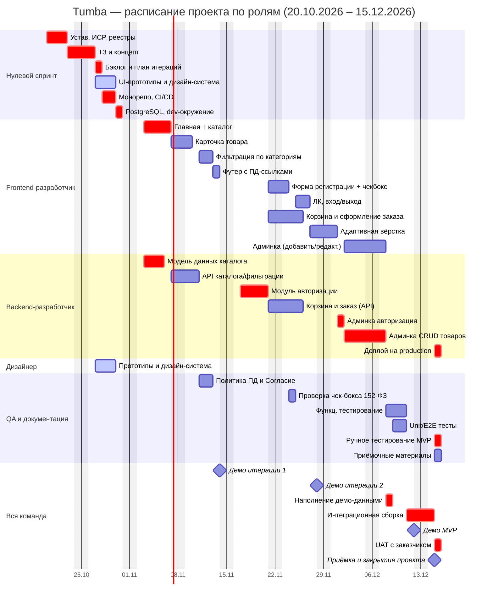

# Расписание проекта и диаграмма Ганта

**Проект:** Tumba — разработка веб-сайта магазина мебели  
**Заказчик:** Магазин мебели «Tumba»  
**Исполнитель:** Команда ИСП (5 человек)  
**Методология:** Гибридная (предиктивное планирование + 4 двухнедельные итерации)  
**Старт проекта:** 20.10.2026 (понедельник)  
**Дедлайн проекта:** 15.12.2026  

## 1. Метод и допущения

### Метод
Расписание составлено на основе Устава проекта, Жизненного цикла проекта, Иерархической структуры работ (ИСР), Бэклога продукта и плана итераций, Реестра рисков. Зависимости и последовательность работ взяты из плана итераций.

### Рабочий календарь
- **Рабочие дни:** Пн–Пт (5 дней в неделю)
- **Выходные:** Сб, Вс
- **Часовой пояс:** MSK (UTC+3)
- **Праздники РФ:** не учитываются в рамках учебного проекта

### Итерации проекта
| Итерация | Период | Режим работы |
|---|---|---|
| **Нулевой спринт (Фаза 4)** | 20.10.2026 – 31.10.2026 (2 недели) | Инициация, планирование, проектирование, настройка инфраструктуры |
| **Итерация 1** | 03.11.2026 – 14.11.2026 (2 недели) | Разработка: каталог, карточка товара, фильтрация, футер с документами по ПД |
| **Итерация 2** | 17.11.2026 – 28.11.2026 (2 недели) | Разработка: личный кабинет, регистрация с согласием по 152-ФЗ, корзина, оформление заказа |
| **Итерация 3** | 01.12.2026 – 12.12.2026 (2 недели) | Разработка: админ-панель, наполнение демо-данными, интеграция, тестирование |
| **Итерация 4 (Тестирование и приёмка)** | 15.12.2026 – 15.12.2026 | Финальное тестирование, UAT, деплой, приёмка и закрытие проекта |

### Объём MVP
Согласно Уставу проекта, в MVP входят:

- Рабочий каталог мебели не менее чем с 8 товарами (название, цена, изображение)
- Карточка товара с возможностью выбора вариаций
- Фильтрация по категориям
- Личный кабинет с регистрацией, входом, выходом
- Сбор персональных данных с отдельным чек-боксом согласия на обработку ПД (152-ФЗ)
- Корзина и оформление заказа (с заглушками оплаты/доставки)
- Панель администратора для добавления и редактирования товаров
- Ссылки на Политику обработки ПД и Согласие на обработку ПД в футере
- Адаптивная вёрстка
- Демонстрационные данные

**Не входят в MVP:** реальные платежи, интеграция с 1С/МойСклад, нативное мобильное приложение, регистрация в Роскомнадзоре, пост-релизная поддержка.

## 2. Команда и роли

| № | Участник | Роль | Зона ответственности |
|---|---|---|---|
| 1 | Руководитель проекта | Project Manager / Team Lead | Управление проектом, планирование, взаимодействие с заказчиком, управление рисками, приёмка |
| 2 | Frontend-разработчик | Frontend Developer | Верстка, UI/UX реализация, адаптивность, клиентская логика, интеграция с API |
| 3 | Backend-разработчик | Backend Developer | Серверная логика, БД, API, авторизация, админ-панель, безопасность |
| 4 | Дизайнер | UI/UX Designer | Дизайн-макеты, прототипы, дизайн-система, UX-концепция |
| 5 | Специалист по QA и документации | QA & Documentation Specialist | Тестирование, проверка соответствия 152-ФЗ, документация, приёмочные материалы |

## 3. Задачи с датами (план по итерациям)

### Нулевой спринт — 20.10.2026 – 31.10.2026

| ID | Задача | Длит., дн. | Начало | Конец | Исполнитель | Предш. | Крит. |
|---|---|---|---|---|---|---|---|
| 1.1 | Устав проекта, ИСР, реестры рисков и стейкхолдеров | 3 | 20.10.2026 | 22.10.2026 | Руководитель проекта + вся команда | — | ✅ |
| 2.1 | ТЗ и концепт продукта | 2 | 23.10.2026 | 24.10.2026 | Руководитель проекта | 1.1 | ✅ |
| 2.2 | Бэклог продукта и план итераций | 1 | 27.10.2026 | 27.10.2026 | Руководитель проекта | 2.1 | ✅ |
| 2.3 | UI-черновики, прототипы в Figma, дизайн-система | 3 | 27.10.2026 | 29.10.2026 | Дизайнер | 2.1 | — |
| 3.1 | Монорепозиторий, настройка CI/CD, линтеры | 2 | 28.10.2026 | 29.10.2026 | Backend-разработчик | 2.1 | ✅ |
| 3.2 | PostgreSQL, dev-окружение, настройка ORM | 1 | 30.10.2026 | 30.10.2026 | Backend-разработчик | 3.1 | ✅ |
| 1.2 | Ведение трекера, планирование итераций | 4 | 20.10.2026 | 23.10.2026 | Руководитель проекта | — | — |

### Итерация 1 — 03.11.2026 – 14.11.2026 (Каталог и базовые страницы)

| ID | Задача | Длит., дн. | Начало | Конец | Исполнитель | Предш. | Крит. |
|---|---|---|---|---|---|---|---|
| S-01 | Главная страница с каталогом мебели (сетка товаров) | 4 | 03.11.2026 | 06.11.2026 | Frontend-разработчик | 3.2, 2.3 | ✅ |
| 4.2 | Базовая модель данных каталога (товары, категории) | 3 | 03.11.2026 | 05.11.2026 | Backend-разработчик | 3.2 | ✅ |
| S-02 | Карточка товара (название, цена, изображение, описание) | 2 | 07.11.2026 | 10.11.2026 | Frontend-разработчик | S-01 | — |
| 4.3 | API каталога и фильтрации | 3 | 07.11.2026 | 11.11.2026 | Backend-разработчик | 4.2 | — |
| S-03 | Фильтрация по категориям | 2 | 11.11.2026 | 12.11.2026 | Frontend-разработчик | S-02, 4.3 | — |
| S-04 | Ссылки на Политику ПД и Согласие в футере | 1 | 13.11.2026 | 13.11.2026 | Frontend-разработчик | S-01 | — |
| 9.2 | Подготовка черновиков Политики ПД и Согласия | 2 | 11.11.2026 | 12.11.2026 | Специалист по QA и документации | — | — |
| 1.3 | Демо по итогам итерации 1 | 1 | 14.11.2026 | 14.11.2026 | Вся команда | S-03, S-04 | — |

### Итерация 2 — 17.11.2026 – 28.11.2026 (ЛК, ПД, корзина)

| ID | Задача | Длит., дн. | Начало | Конец | Исполнитель | Предш. | Крит. |
|---|---|---|---|---|---|---|---|
| 4.1 | Модуль авторизации (регистрация, вход, выход) | 4 | 17.11.2026 | 20.11.2026 | Backend-разработчик | 4.2 | ✅ |
| S-05 | Форма регистрации с вводом персональных данных | 2 | 21.11.2026 | 24.11.2026 | Frontend-разработчик | 4.1 | — |
| S-06 | Отдельный чек-бокс согласия на обработку ПД (152-ФЗ) | 1 | 24.11.2026 | 24.11.2026 | Frontend-разработчик + QA | S-05, 9.2 | ✅ |
| S-07 | Личный кабинет (профиль, вход/выход) | 2 | 25.11.2026 | 26.11.2026 | Frontend-разработчик | S-05 | — |
| S-08 | Добавление товара в корзину | 2 | 21.11.2026 | 24.11.2026 | Frontend + Backend | 4.3 | — |
| S-09 | Оформление заказа (форма + заглушки оплаты/доставки) | 2 | 25.11.2026 | 26.11.2026 | Frontend + Backend | S-08 | ✅ |
| S-10 | Вариации товара (цвет обивки, размер) | 2 | 25.11.2026 | 26.11.2026 | Frontend + Backend | S-02 | — |
| S-11 | Адаптивная вёрстка (мобильные устройства) | 2 | 27.11.2026 | 28.11.2026 | Frontend-разработчик | S-01,S-08 | — |
| 1.3 | Демо по итогам итерации 2 | 1 | 28.11.2026 | 28.11.2026 | Вся команда | S-09,S-11 | — |

### Итерация 3 — 01.12.2026 – 12.12.2026 (Админ-панель и интеграция)

| ID | Задача | Длит., дн. | Начало | Конец | Исполнитель | Предш. | Крит. |
|---|---|---|---|---|---|---|---|
| S-12 | Авторизация в админ-панели (роль администратора) | 1 | 01.12.2026 | 01.12.2026 | Backend-разработчик | 4.1 | ✅ |
| S-13 | Добавление нового товара в админ-панели | 2 | 02.12.2026 | 03.12.2026 | Backend + Frontend | S-12, 4.2 | ✅ |
| S-14 | Редактирование товара в админ-панели | 2 | 04.12.2026 | 05.12.2026 | Backend + Frontend | S-13 | ✅ |
| S-15 | Наполнение демо-данными (не менее 8 товаров) | 1 | 08.12.2026 | 08.12.2026 | Вся команда | S-13 | ✅ |
| 5.1 | Функциональное тестирование, проверка безопасности форм и ПД | 3 | 08.12.2026 | 10.12.2026 | Специалист по QA и документации | S-09,S-14 | — |
| S-16 | Unit/E2E тесты ключевых сценариев | 2 | 09.12.2026 | 10.12.2026 | Backend + QA | 4.1,4.2,4.3 | — |
| Интеграция | Интеграционная сборка всех модулей | 2 | 11.12.2026 | 12.12.2026 | Вся команда | S-14,S-15 | ✅ |
| 1.3 | Демо MVP по итогам итерации 3 | 1 | 12.12.2026 | 12.12.2026 | Вся команда | Интеграция | — |

### Итерация 4 — 15.12.2026 – 15.12.2026 (Тестирование, UAT, приёмка)

| ID | Задача | Длит., дн. | Начало | Конец | Исполнитель | Предш. | Крит. |
|---|---|---|---|---|---|---|---|
| S-18 | Ручное тестирование MVP, проверка по чек-листу приёмки, фиксы критичных багов | 1 | 15.12.2026 | 15.12.2026 | Вся команда | Интеграция | ✅ |
| 5.2 | UAT с заказчиком | 0.5 | 15.12.2026 | 15.12.2026 | Руководитель проекта + QA | S-18 | ✅ |
| S-19 | Деплой на production, настройка домена и SSL | 0.5 | 15.12.2026 | 15.12.2026 | Backend-разработчик | S-18 | ✅ |
| S-20 | Подготовка и сдача приёмочных материалов (Акт приёма-передачи, инструкции для админа, Политика ПД, Согласие) | 0.5 | 15.12.2026 | 15.12.2026 | Специалист по QA и документации | 9.2, S-18 | ✅ |

**Легенда:** «Крит.» — задачи на критическом пути проекта. Остальные могут быть сдвинуты при наличии резерва времени.

**Критический путь:** 1.1 → 2.1 → 3.1 → 3.2 → 4.2 → S-01 → 4.1 → S-06 → S-09 → S-12 → S-13 → S-14 → Интеграция → S-18 → S-19/S-20

## 4. Разрешение ресурсных конфликтов

| № | Конфликт | Кто | Как разрешён | Влияние на срок |
|---|---|---|---|---|
| 1 | Параллельная разработка дизайна и инфраструктуры | Дизайнер, Backend-разработчик | Дизайн-макеты (2.3) и настройка монорепозитория/БД (3.1-3.2) выполняются параллельно в нулевом спринте | Нет влияния |
| 2 | Frontend и Backend зависят друг от друга | Frontend и Backend | API First-подход: сначала проектирование модели данных и API-контрактов (4.2), затем параллельная разработка | Минимизировано за счёт ранней синхронизации |
| 3 | Проверка соответствия 152-ФЗ | QA и разработчики | Специалист по QA готовит документы по ПД (9.2) параллельно с разработкой ЛК, интеграция чек-бокса обязательна в DoD | Контролируется на итерации 2 |
| 4 | Единый ресурс на тестирование | Специалист по QA и документации | Тестирование распределено по итерациям (функциональное в Ит3, приёмочное в Ит4) | Равномерная загрузка |
| 5 | Интеграция всех модулей в конце | Вся команда | Отдельный блок «Интеграция» в Итерации 3 с участием всей команды для устранения конфликтов | Фокус всех ресурсов на сборке MVP |

## 5. Загрузка по людям

| Участник | Основные задачи | Примерная трудоёмкость | Примечание |
|---|---|---|---|
| **Руководитель проекта** | 1.1, 2.1, 2.2, 1.2, 1.3, 5.2 | ~16-20 ч | Управление, планирование, взаимодействие с заказчиком |
| **Frontend-разработчик** | S-01,S-02,S-03,S-04,S-05,S-07,S-08,S-09,S-11,S-13,S-14 | ~60-70 ч | Основной объём UI-реализации, адаптивность |
| **Backend-разработчик** | 3.1,3.2,4.2,4.1,4.3,S-08,S-09,S-12,S-13,S-14,S-19 | ~55-65 ч | API, БД, авторизация, админка, деплой |
| **Дизайнер** | 2.3 | ~12-16 ч | Прототипы и дизайн-система в нулевом спринте |
| **Специалист по QA и документации** | 9.2, S-06, 5.1, 5.2, S-18, S-20 | ~25-30 ч | Тестирование, проверка 152-ФЗ, приёмочные материалы |

*Нагрузка оценена с учётом частичной занятости команды в рамках учебного проекта.*

## 6. Диаграмма Ганта

## 7. Вехи проекта

| Веха | Дата | Что готово |
|---|---|---|
| **M0 — Старт проекта** | 20.10.2026 | Утверждён Устав, сформирована команда, старт планирования |
| **M1 — Нулевой спринт завершён** | 31.10.2026 | Монорепо, БД, CI/CD настроены. Утверждён бэклог, дизайн-прототипы в Figma |
| **M2 — Конец итерации 1** | 14.11.2026 | Рабочий каталог с 8+ товарами, фильтрация по категориям, карточка товара, футер с документами по ПД |
| **M3 — Конец итерации 2** | 28.11.2026 | Личный кабинет с регистрацией и согласие по 152-ФЗ, корзина, оформление заказа (заглушки), адаптивная вёрстка |
| **M4 — MVP собран** | 12.12.2026 | Админ-панель, демо-данные, интеграция всех модулей. Полностью рабочий прототип по сценарию «просмотр каталога — корзина — оформление заказа» |
| **M5 — Приёмка и закрытие** | 15.12.2026 | UAT пройден, сайт задеплоен, приёмочные материалы сданы, Акт приёма-передачи подписан |

## 8. Критерии приёмки (чек-лист)

- [ ] Открывается главная страница с каталогом мебели (не менее 8 товаров с названием, ценой и изображением)
- [ ] Работает фильтрация по категориям
- [ ] Работает просмотр карточки товара
- [ ] Реализована регистрация нового пользователя с вводом персональных данных
- [ ] В форме регистрации есть **отдельный** чек-бокс согласия на обработку персональных данных
- [ ] В футере сайта есть ссылки на «Политику обработки персональных данных» и «Согласие на обработку персональных данных»
- [ ] Работает вход в личный кабинет и выход из него
- [ ] Можно добавить товар в корзину и оформить заказ (с имитацией оплаты и доставки)
- [ ] В админ-панели можно добавить новый товар и отредактировать существующий
- [ ] Сайт адаптивен для мобильных устройств
- [ ] Демонстрация сквозного сценария проходит без критических ошибок
- [ ] Подготовлен комплект приёмочных материалов

## 9. Риски и меры реагирования

| Риск | Приоритет | Мера реагирования |
|---|---|---|
| **R-01. Сложная модель вариаций мебели** | Критический | Спроектировать БД с SKU и вариациями до начала разработки корзины. При невозможности — упростить до плоского списка товаров |
| **R-03. Слепое копирование кода из ИИ** | Критический | Правило: «Код, который автор не может объяснить на ревью, не принимается». Обязательное код-ревью |
| **R-04. Нарушение требований 152-ФЗ** | Критический | Чек-бокс согласия — только отдельный, ссылки в футере обязательны. Проверка в DoD и на QA-этапе |
| **R-05. Выпадение участника команды** | Критический | Кросс-ревью, документация ключевых решений, перераспределение задач между участниками |
| **R-08. Проблемы с адаптивностью** | Высокий | Mobile-first подход, тестирование на мобильных разрешениях в Итерации 2 |
| **R-10. Битые демо-данные** | Высокий | Валидация перед демо, проверка ссылок на изображения и корректности цен |

## 10. Резерв времени

- **Встроенный резерв:** 15-20% времени заложены в оценках задач
- **Буфер на итерацию:** между завершением разработки и демонстрацией отведено время на фиксы
- **Финальный буфер:** в день приёмки (15.12.2026) предусмотрено время на устранение мелких замечаний по результатам UAT
- **Стратегия при отставании:** по приоритету урезаются задачи S-10 (вариации) и S-11 (расширенная адаптивность), в первую очередь сохраняются Must-задачи из бэклога
